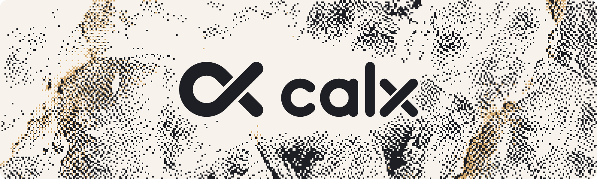

<picture>
  <source media="(prefers-color-scheme: dark)" srcset="assets/logo/calx-banner-dark.png">
  
</picture>

Calx is a compiled systems language built for [Calcite](https://github.com/ellipog/calcite), a Minecraft Java Edition server. Its compiler is written in C++ and emits C, which clang builds on Windows and Linux.

What sets it apart:

- **Faster than Rust.** On the tick-loop benchmark, which uses the same algorithms and gives the same checksum as its Rust reference, Calx takes about 0.7× Rust's time per tick, with one thread or 24, on Windows and Linux.
- **Java-exact math.** Integers and floats behave exactly as they do in Java, so Calcite can reproduce vanilla Minecraft bit for bit.
- **Memory-safe by default.** Ownership is checked at compile time and costs nothing at run time: no garbage collector, no reference counts. Unchecked code is opt-in and limited to the server core and plugins you trust.
- **Deterministic parallelism.** `parallel for` runs a loop's iterations across every core, and the compiler checks that no iteration touches what another one changes. A program prints the same output with one thread or many. Region actors come next.
- **Stricter than Rust.** No implicit conversions, no dropped values, no unused names and no shadowing. Each mistake gets an error that says what to write instead.
- **Fast to build.** `calx run` on a small program takes about 0.3 s from an empty cache and under 25 ms when nothing changed.

Status: Phase 3's gate has passed and is in review. The compiler builds integers, floats, arrays, structs, enums, tuples, optionals, `match`, generics, interfaces, modules, `String`, `List`, `Map` and `Set`, error values (`T ! E`, `fail`, `try`), `unsafe` code with C functions, and `parallel for`. They give Java's results on Windows and Linux. The standard library has `std.io`, `std.env`, `std.time`, `std.math` and `std.java.math`, `std.pool`, `std.net` (TCP driven by events on IOCP and epoll), `std.mail` (messages between actors), `std.text.mutf8`, `std.hash`, `std.crypto`, `std.zlib`, `std.lz4` and `std.http`, and the Java-compatible collections and strings are built. The [reference](docs/README.md#reference) lists what's built.

## Performance

Milliseconds per tick on the [tick-loop benchmark](bench/README.md), measured on an i9-13900K. Each figure is the median of 10 runs of 1,000 ticks. The Rust reference was built with rustc 1.91.1, and Calx with clang 23.

| Platform | Calx, 1 worker | Rust, 1 worker | Calx, 24 workers | Rust, 24 workers |
| --- | --- | --- | --- | --- |
| Windows 11 | **18.06** | 25.75 | **2.25** | 3.41 |
| Linux (WSL2) | **18.01** | 26.04 | **2.46** | 3.52 |

Build times on the same machine:

| | Windows 11 | Linux (WSL2) |
| --- | --- | --- |
| `calx check`, 64 modules (9,900 lines) | 32 ms | 24 ms |
| Debug build of those 64 modules, empty cache | 520 ms | 278 ms |
| Debug rebuild after changing one module | 123 ms | 78 ms |
| `calx run` of a small program, empty cache | 274 ms | 302 ms |
| `calx run` of it again, nothing changed | 16 ms | 21 ms |

CI runs the benchmark and checks its checksum on every push. It also times the builds. The raw results are in [bench/results](bench/results).

## Building

You need CMake, Ninja and clang (LLVM 18 or later, with lld).

```sh
cmake -S compiler -B build/compiler -G Ninja -DCMAKE_CXX_COMPILER=clang++
ninja -C build/compiler
build/compiler/calx run tests/basics/hello.calx
```

`python tests/run.py` builds the compiler and runs the test suite, which includes every example in the docs. CI runs it in debug and release on Windows and Linux.

## Editors

The VS Code extension in [tools/vscode](tools/vscode/README.md) highlights Calx, shows the compiler's errors as you type, and runs files. Install it with `python tools/vscode/package.py --install`. Other editors can use its TextMate grammar and `calx check --json` ([editor support](docs/reference/editors.md)).

Acta board: aaen-studios/clx ([open](https://acta.aaenz.no/aaen-studios/clx)). The phase gates are on Calcite's board, aaen-studios/calcite.

## Docs

Start at [docs/README.md](docs/README.md). The docs are written alongside the language, so they always describe what's actually built.

## License

MIT
